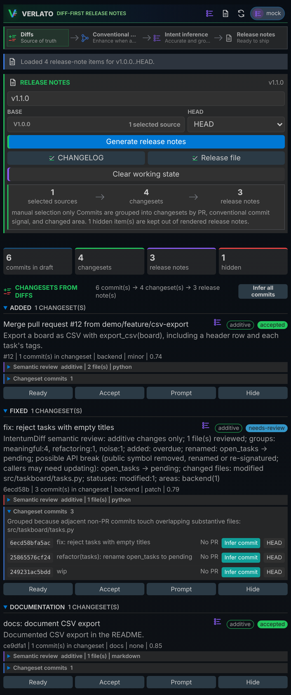
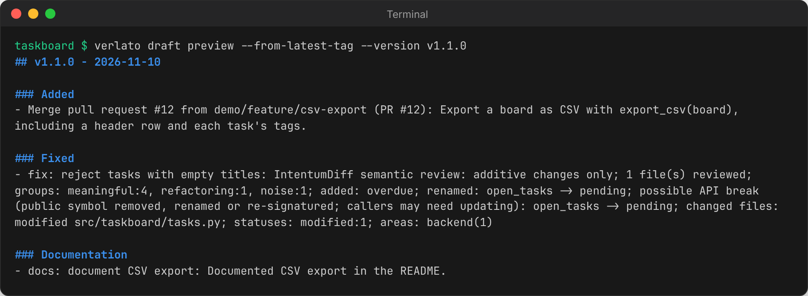

# Verlato

**Release notes you can trust, drafted from what your code actually changed.**

Verlato reads the commits between two refs, groups them into pull-request-sized changesets,
works out what each one did, and drafts a changelog entry and GitHub release notes for you to
review and apply. It is powered by the [IntentumDiff](https://github.com/buchochelliq-labs/intentumdiff-core)
semantic diff engine: every commit is reviewed structurally, so Verlato knows whether a change
is behavioural, additive, a refactoring or move, or formatting only, and which functions,
methods and classes were added, removed, renamed or re-signatured. A vague `wip` commit that
renames a public function is flagged as a possible breaking change.

Use it from the **command line**, the **VS Code extension** or any **MCP client**. Models are
optional and local by default; they see the semantic diff, never your raw patches, unless you
allow it.

**Documentation: <https://buchochelliq-labs.github.io/verlato-core/>**



## Install

```sh
pip install verlato              # CPython 3.12+; Linux, macOS, Windows
```

Or download a self-contained bundle (the `verlato` executable plus its parser bundle) for your
platform from [GitHub Releases](https://github.com/buchochelliq-labs/verlato-core/releases), or
[build from source](https://buchochelliq-labs.github.io/verlato-core/technical/building/).
The VS Code extension is in [`vscode-extension/`](vscode-extension/).

## Quickstart

From inside a git repository with at least one tag:

```sh
verlato draft preview --from-latest-tag --version v1.1.0
```



Then review the items, apply the notes, and record the release:

```sh
verlato draft json --from-latest-tag                                 # items, evidence, semantic review
verlato draft review --from-latest-tag --id <item-id> --status accepted --summary "..."
verlato draft apply --from-latest-tag --version v1.1.0 --target changelog
git tag -a v1.1.0 -m v1.1.0
verlato generate --base <previous-tag> --head v1.1.0
verlato state mark-published --version v1.1.0 --all-unpublished
```

Want better wording? Run a local [Ollama](https://ollama.com) model and try
`verlato draft suggest --from-latest-tag --all-visible --preview`.

## Learn more

- [Getting started](https://buchochelliq-labs.github.io/verlato-core/getting-started/)
- User guide: [the command line](https://buchochelliq-labs.github.io/verlato-core/guide/cli/),
  [the VS Code extension](https://buchochelliq-labs.github.io/verlato-core/guide/vscode/),
  [models](https://buchochelliq-labs.github.io/verlato-core/guide/models/),
  [privacy modes](https://buchochelliq-labs.github.io/verlato-core/guide/privacy/),
  [the MCP server](https://buchochelliq-labs.github.io/verlato-core/guide/mcp/)
- Reference: [CLI](https://buchochelliq-labs.github.io/verlato-core/reference/cli/),
  [`verlato.json`](https://buchochelliq-labs.github.io/verlato-core/reference/configuration/),
  [environment variables](https://buchochelliq-labs.github.io/verlato-core/reference/environment/),
  [Python API](https://buchochelliq-labs.github.io/verlato-core/reference/python/)
- Technical guide: [architecture](https://buchochelliq-labs.github.io/verlato-core/technical/architecture/),
  [semantic evidence](https://buchochelliq-labs.github.io/verlato-core/technical/semantic-evidence/),
  [extension points](https://buchochelliq-labs.github.io/verlato-core/technical/extending/)

The documentation's source is in [`docs/`](docs/); build it with
`pip install zensical==0.0.74 && zensical build --strict`.

## Contributing

See [CONTRIBUTING.md](CONTRIBUTING.md). In short: `cargo test --workspace`, `pytest` (after
`pip install -e '.[dev]'`) and `npm test` in `vscode-extension/`.

## License and open core

Verlato is licensed under the [Apache License, Version 2.0](LICENSE); see also
[NOTICE](NOTICE). Releases before the relicensing were published under the MIT License.

Verlato is open core: everything one developer needs is here and free. Team and organisation
features are built separately on core's public extension points; see
[Open core](https://buchochelliq-labs.github.io/verlato-core/open-core/).
