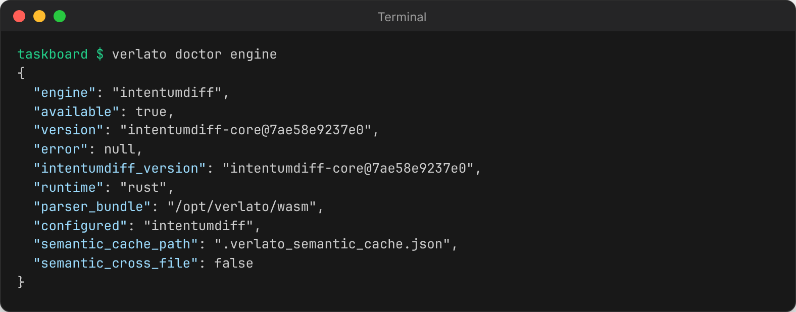
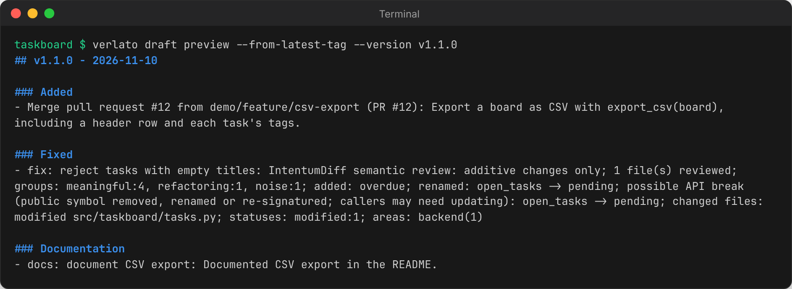

# Getting started

## Install

Verlato is a single native program with the IntentumDiff engine linked in. It needs git on
`PATH`, and the IntentumDiff parser bundle (a directory of WebAssembly parsers), which every
distribution below includes. Pick one.

### With pip

```sh
pip install verlato
```

The [`verlato` package on PyPI](https://pypi.org/project/verlato/) is a thin wrapper over the
native runtime, for CPython 3.12 or newer on Linux (x86_64, aarch64), macOS (Apple Silicon and
Intel) and Windows (x64). It installs the `verlato` and `verlato-mcp` commands and a small
[Python API](reference/python.md), and carries the parser bundle inside the wheel. It has no
other dependencies. `pipx install verlato` or `uv tool install verlato` work too.

### From a release bundle

Each [GitHub release](https://github.com/buchochelliq-labs/verlato-core/releases) has a
self-contained archive per platform, `verlato-v<version>-<target>.tar.gz` (`.zip` on
Windows), and a `SHA256SUMS` file:

```sh
sha256sum -c SHA256SUMS --ignore-missing
tar -xzf verlato-v0.2.0-x86_64-unknown-linux-gnu.tar.gz
verlato-v0.2.0-x86_64-unknown-linux-gnu/verlato --version
```

The archive holds the `verlato` executable with the parser bundle beside it in `wasm/`. Keep
the two together, then put the directory on `PATH` (or point the VS Code extension's
`verlato.cliPath` setting at the executable). Targets: `x86_64-unknown-linux-gnu`,
`aarch64-unknown-linux-gnu`, `aarch64-apple-darwin`, `x86_64-apple-darwin` and
`x86_64-pc-windows-msvc`.

### From source

```sh
git clone https://github.com/buchochelliq-labs/verlato-core
cd verlato-core
cargo build --release -p verlato
scripts/fetch_intentumdiff_parsers.sh          # parser bundle -> target/release/wasm
target/release/verlato --version
```

See [Building from source](technical/building.md) for the Python package and the extension.

### Check the installation

```sh
verlato doctor engine
```



`available: true` means the semantic engine and its parser bundle were found. If it says
the parser bundle was not found, see [Troubleshooting](guide/troubleshooting.md#the-parser-bundle-was-not-found).

## Your first release notes

Run Verlato from inside a git repository. Release notes are always for a **range** of
commits: from a base (excluded) to a head (included, `HEAD` by default). The easiest base is
your latest tag:

```sh
verlato draft preview --from-latest-tag --version v1.1.0
```



Verlato collected the commits since the tag, grouped them into changesets (a merged pull
request is one changeset; adjacent commits that touch the same files are another), sorted
them into Keep a Changelog sections, and summarised each from its commit messages and the
semantic review. Nothing was changed: `draft preview` only prints.

Other ways to choose the range:

```sh
verlato draft preview --base v1.0.0                 # an explicit base (tag, branch or commit)
verlato draft preview --base v1.0.0 --head release  # and an explicit head
verlato draft preview --from-latest-published       # since the last release you recorded
```

## Review, apply and record a release

A typical release with the command line:

1. **Look at the items and their evidence** as JSON:

    ```sh
    verlato draft json --from-latest-tag --version v1.1.0
    ```

    Each item has an `id` (`ci_...`), its section, summary, status, confidence, files,
    commit signals and, with IntentumDiff, its `semantic` review.

2. **Review items.** Items Verlato is less sure about start as `needs-review`. Fix a summary,
   accept an item, or hide one from the notes:

    ```sh
    verlato draft review --from-latest-tag --id ci_972e95f9aba2 --status accepted \
      --summary "Export a board as CSV with export_csv(board)."
    verlato draft review --from-latest-tag --id ci_6dfa7357c7f6 --status hidden
    ```

    Review decisions are saved in `.verlato_state.json` and survive later runs.

3. **Optionally ask a model for better wording** (see [Models and providers](guide/models.md)):

    ```sh
    verlato draft suggest --from-latest-tag --all-visible --preview   # look first
    verlato draft suggest --from-latest-tag --id ci_715c52ad2c02      # apply one
    ```

4. **Apply the notes** to your changelog (and, if you like, a GitHub release file):

    ```sh
    verlato draft apply --from-latest-tag --version v1.1.0 --target changelog
    verlato draft apply --from-latest-tag --version v1.1.0 --target github-release
    ```

    The targets' paths come from `verlato.json` (by default `CHANGELOG.md` and
    `.github/release.md`); `--file` writes somewhere else.

5. **Tag and record the release**, so the next run can start from it:

    ```sh
    git tag -a v1.1.0 -m v1.1.0
    verlato generate --base v1.0.0 --head v1.1.0
    verlato state mark-published --version v1.1.0 --all-unpublished
    ```

    `generate` saves the range's items to state and `mark-published` records which release
    they shipped in. Next time, `--from-latest-published` starts from `v1.1.0` (the recorded
    version must be a git ref, so use the tag name).

## Next steps

- Prefer the editor? Install the [VS Code extension](guide/vscode.md): it does all of the
  above from a side bar view.
- Configure targets, a model provider and your writing style in
  [`verlato.json`](reference/configuration.md).
- Let an agent do it: [The MCP server](guide/mcp.md).
- Learn what Verlato looks at: [Concepts](guide/concepts.md) and
  [Semantic evidence](technical/semantic-evidence.md).
