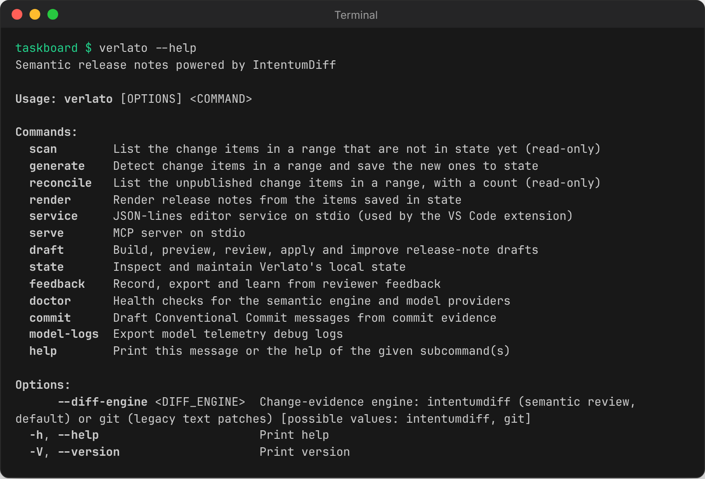

# The command line

This page walks through the commands by task. The [CLI reference](../reference/cli.md) lists
every flag, generated from `verlato --help`. Run every command from inside the repository; JSON
goes to stdout, and diagnostics and progress go to stderr.



## Find what changed

```sh
verlato scan --from-latest-tag            # change items not in state yet (JSON array)
verlato reconcile --from-latest-tag       # unpublished items in the range, with a count
verlato generate --from-latest-tag        # detect items and save the new ones to state
```

`scan` and `reconcile` never change anything; `generate` saves new items to
`.verlato_state.json`. Items already in state are recognised by checksum and never
duplicated. All three accept the [range options](concepts.md#ranges) and the model options
below.

## Draft release notes

```sh
verlato draft preview --from-latest-tag --version v1.1.0    # GitHub release notes (Markdown)
verlato draft json --from-latest-tag --version v1.1.0       # the full draft document (JSON)
```

`--version` sets the release heading (default `Unreleased`). `--include-confidence` and
`--include-provenance` add each item's confidence score, PR and commits to the rendered
Markdown. Hidden items are left out of the Markdown but stay in the JSON. The JSON shape is
described in [Output formats](../reference/output-formats.md#draft-documents).

To render notes from the items saved in state, rather than a range, use
`verlato render --format changelog|github-release --version v1.1.0`.

## Review items

```sh
verlato draft review --from-latest-tag --id ci_972e95f9aba2 --status accepted --reviewer alice
verlato draft review --from-latest-tag --id ci_972e95f9aba2 --summary "Export a board as CSV."
verlato draft review --from-latest-tag --id ci_6dfa7357c7f6 --status hidden
```

`--status` takes `needs-review`, `ready`, `accepted`, `edited` or `hidden`. Saving a
`--summary` marks the item `edited` (unless you also pass a status) and keeps the original
generated summary for reference. Decisions are saved in state and apply to every later run
over a range containing the item.

## Apply notes to files

```sh
verlato draft apply --from-latest-tag --version v1.1.0                          # CHANGELOG.md
verlato draft apply --from-latest-tag --version v1.1.0 --target github-release  # .github/release.md
verlato draft apply --from-latest-tag --version v1.1.0 --file docs/releases/v1.1.0.md
```

The answer says which file was written and whether it was created or updated. Configure the
target paths in [`verlato.json`](../reference/configuration.md#targets).

## Record a release

```sh
git tag -a v1.1.0 -m v1.1.0
verlato generate --base v1.0.0 --head v1.1.0
verlato state mark-published --version v1.1.0 --all-unpublished    # or --ids ci_... ci_...
```

After this, `--from-latest-published` starts at `v1.1.0`, and the items carry
`published_in: v1.1.0`. Other state commands:

```sh
verlato state show                     # the saved state as JSON
verlato state clear-working            # drop unpublished items (and their feedback); keep history
verlato state clear-suggestion-cache   # delete the model suggestion cache
```

## Improve wording with a model

These commands need a [model provider](models.md); the default is a local Ollama model.

```sh
# Look before you change anything: suggestions for every visible item, as JSON.
verlato draft suggest --from-latest-tag --all-visible --preview

# Apply the suggestion for one item (saved as its summary, with provenance).
verlato draft suggest --from-latest-tag --id ci_715c52ad2c02 --reviewer alice

# The exact prompt, evidence and audit record a suggestion would send; calls no model.
verlato draft prompt --from-latest-tag --id ci_715c52ad2c02

# The planned requests without calling the provider.
verlato draft suggest --from-latest-tag --all-visible --preflight
```

Useful options: `--count` (up to 5 suggestions per item), `--tone release-note|concise|technical|customer-facing`,
`--strategy auto|single|paired|full-diff-json|tool-retrieval`, `--parallelism`,
`--batch-size`, `--suggest-model` (a smaller model just for suggestions), `--prompt-profile`,
`--no-cache` / `--refresh-cache`, and `--trace-suggestions` (diagnostics on stderr). Strategies
are explained in [Models and providers](models.md#suggestion-strategies) and the wording
controls in [Writing style and vocabulary](style.md).

### Model options shared by most commands

| Option | Effect |
|---|---|
| `--model-provider <name>` | provider for this run (`stub`, `mock`, `ollama`, `litellm`, `plugin`, `github-copilot`, `codex-cli`, `claude-code`) |
| `--privacy <mode>` | `metadata-only`, `local-summary-then-ai` or `trusted-provider-patch` ([Privacy modes](privacy.md)) |
| `--allow-remote-patches` | allow `trusted-provider-patch` for a remote provider |
| `--infer-commit-intents` / `--no-infer-commit-intents` | turn [commit intent inference](models.md#commit-intent-inference) on or off for this run |
| `--diff-engine intentumdiff\|git` | the evidence engine (a global option, accepted anywhere) |

## Conventional Commit messages

Draft a full Conventional Commit message for an existing commit, from its diff:

```sh
verlato commit conventional --base v1.0.0 --sha 249231a
```

```json
{
  "header": "chore(general): update commit diff",
  "message": "chore(general): update commit diff\n\n- Updated files according to the commit-scoped diff evidence.",
  "type": "chore",
  "scope": "general",
  "breaking": false,
  "confidence": 0.84,
  "privacy": { "mode": "metadata-only", "raw_patch_chars_sent": 0 },
  "...": "..."
}
```

(That draft is from the deterministic `mock` provider; a real model writes a real
description.) By default the model does not see the commit's own message
(`--evidence-mode diff-only`), so a vague `wip` gets an honest description; pass
`--evidence-mode subject-hint` to include it.

## Feedback

Review actions and suggestion outcomes are recorded as feedback events in state. You can also
record your own, and learn from them:

```sh
verlato feedback record --event useful --item-id ci_715c52ad2c02
verlato feedback export --output feedback.json        # or --format jsonl, --event <name>
verlato feedback recommend                            # prompt and style advice from the aggregates
```

See [Writing style and vocabulary](style.md#feedback).

## Health checks and logs

```sh
verlato doctor engine        # is the IntentumDiff engine and its parser bundle available?
verlato doctor ollama        # load, queue and generation timing of a local Ollama model
verlato doctor model         # probe the configured suggestion model with a tiny request
verlato model-logs export --file model-debug.jsonl --output model-export.json
```

See [Troubleshooting](troubleshooting.md) and [Model telemetry](../technical/model-telemetry.md).

## Long-running servers

```sh
verlato serve      # the MCP server on stdio, for MCP clients (same as verlato-mcp)
verlato service    # the JSON-lines editor service on stdio, used by the VS Code extension
```

See [The MCP server](mcp.md) and [Service and MCP protocol](../reference/protocol.md).

## Exit codes

`0` on success, `1` when a command fails (the reason is on stderr), and `2` for usage errors
such as an unknown command or a missing required option.
