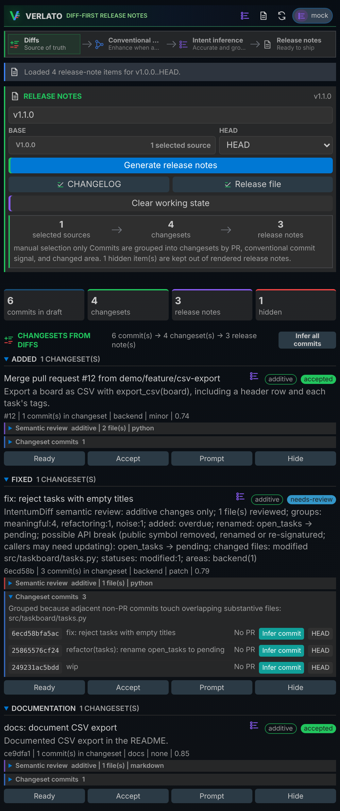
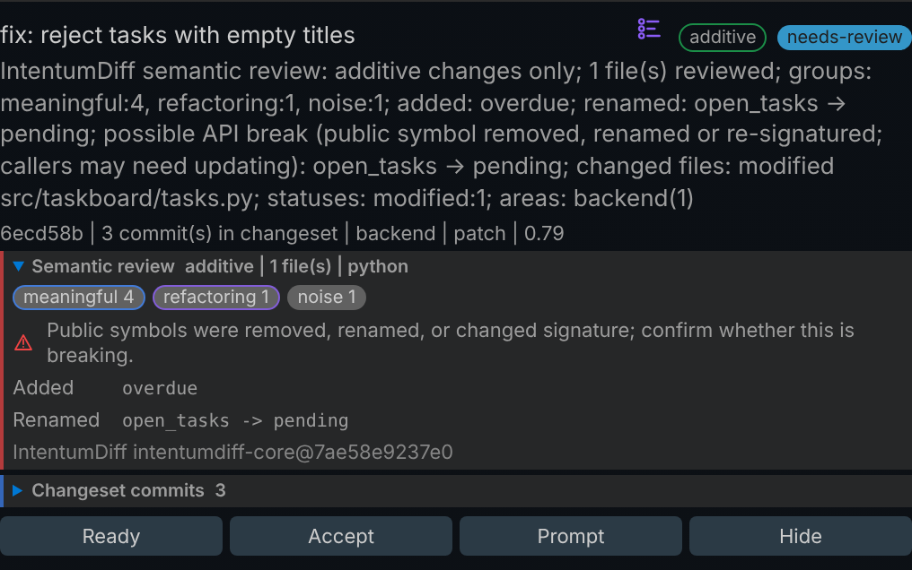
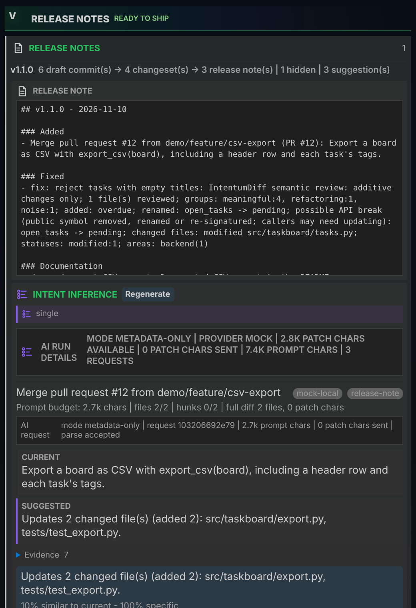
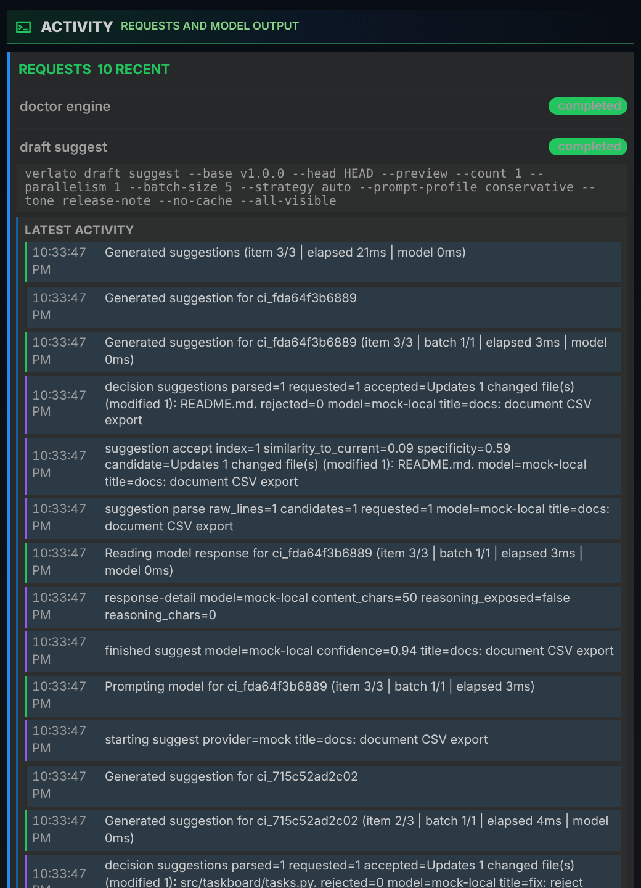
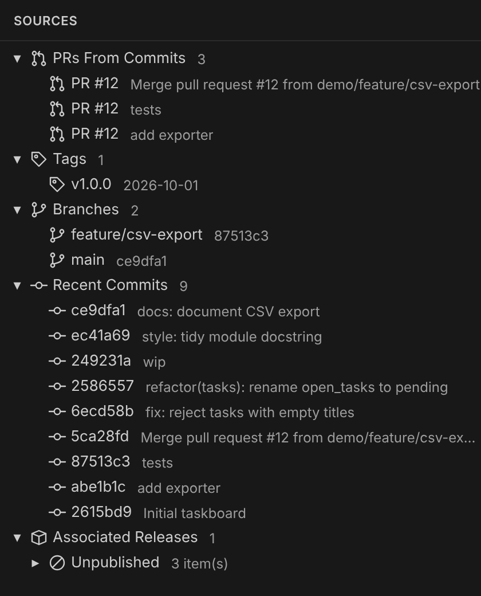
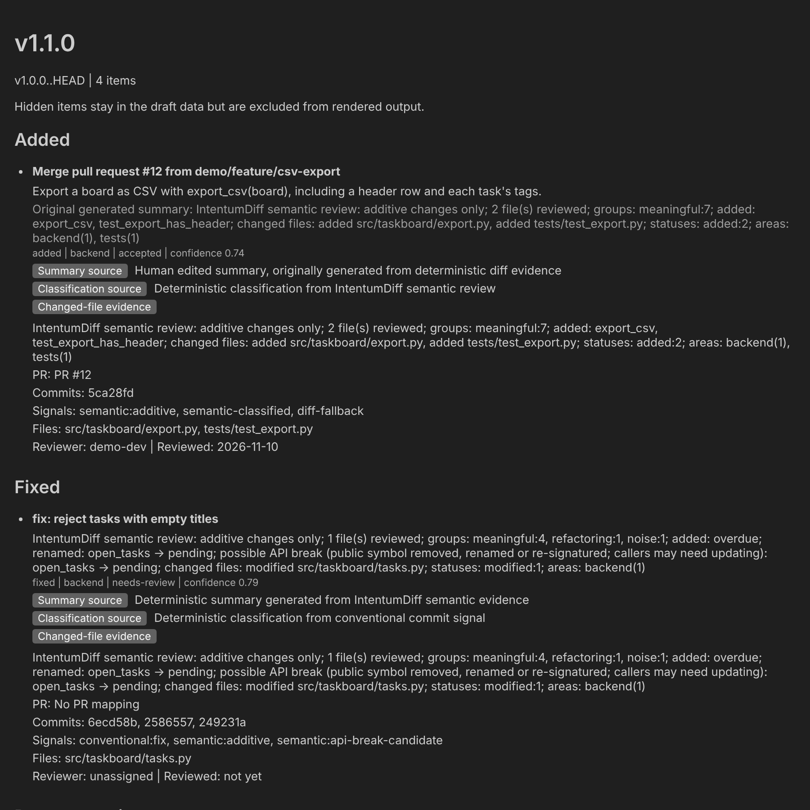

# The VS Code extension

The Verlato extension puts the whole release-note workflow in a VS Code side bar: pick a
range, read each changeset with its semantic review, accept or fix the wording (or ask a
model), and apply the notes to `CHANGELOG.md` or a release file. It drives the same `verlato`
program as the command line, so everything it does can also be scripted.

{ width="420" align="right" }

## Install

1. **Install Verlato itself**, one of:
    - `pip install verlato` (the `verlato` command lands on `PATH`);
    - unpack a [release bundle](../getting-started.md#from-a-release-bundle), then set
      **`verlato.cliPath`** to its `verlato` executable (or put its directory on `PATH`).
2. **Install the extension**: from a `.vsix` file with *Extensions: Install from VSIX...*, or
   build one from source (see [Building from source](../technical/building.md#the-vs-code-extension)).
   It needs VS Code 1.90 or later.
3. **Open a git repository** and click the Verlato icon in the activity bar.

The extension looks for `verlato` in this order: the `verlato.cliPath` setting (when it is not
the default `verlato`); a release bundle unpacked into the extension's own `bin/` directory;
`target/release/verlato` next to the extension (a source checkout); a `.venv` in the workspace,
the extension directory or its parent; and finally `verlato` on `PATH`.

## The views

The Verlato container has four views.

### Control

The main view (shown on the right). From top to bottom:

- **Header:** scan, preview, refresh and the current **model** (click it to change provider
  and model).
- **Process rail:** where evidence comes from (diffs, Conventional Commits, intent inference)
  and the release notes they lead to.
- **Release notes card:** the version heading, the **base** and **head** of the range (pick a
  tag, branch, commit or PR from the sources picker), and the actions **Generate release
  notes**, apply to **CHANGELOG** or the **Release file**, and **Clear working state**. A
  summary shows how many sources, changesets and release notes the draft has, and how many
  items are hidden.
- **Changesets from diffs:** every draft item, grouped by section. Each shows its title,
  summary, semantic verdict badge (behavioral, additive, refactor only, style only)
  and review status, then its PR or commit, area, SemVer impact and confidence. Expand
  **Semantic review** for the IntentumDiff details and **Changeset commits** for the commits
  (each with **Infer commit**, which drafts a Conventional Commit message from the diff and
  copies it to the clipboard; **Infer all commits** does the whole draft). Buttons: **Ready**,
  **Accept**, **Prompt** (shows the exact model prompt) and **Hide** / **Unhide**. The list
  icon next to the title asks the model for a new summary.
- **Intent inference:** the suggestion run: strategy, privacy mode, how much patch text was
  available and sent, and for each item the current and suggested summaries with their
  evidence. **Apply**, **Skip**, mark a suggestion useful or not, change the **tone**, or
  **Regenerate** one or all. Model health and **Warm model** run the
  [`doctor ollama`](troubleshooting.md#doctor-ollama) checks.

The semantic review lists the change groups IntentumDiff found (meaningful, refactoring,
moved, style, noise), the symbols added, removed, renamed or re-signatured, guardrail
violations and files it could not review. A warning marks possible API breaks; such items stay
in **needs-review** until someone looks.

### Releases

The rendered release note for the current draft, ready to copy, with the suggestion run below
it. **Use as base** / **Use as head** on a release sets the Control view's range.

{ width="420" }

### Activity

Every command the extension ran, newest first, with its arguments, status and live output.
Model calls stream their progress here: planning, prompting, the response, parsing and the
decision for each suggestion. Prompt and response payloads are hidden unless
`verlato.telemetry.includePromptPayloads` is on (see
[Model telemetry](../technical/model-telemetry.md)). Running requests can be cancelled.

{ width="420" }

### Sources

A tree of what a range can start or end at: PRs found in commits, tags, branches, recent
commits, and the releases recorded in state with the commits associated with each. Click a
commit to open it.

{ width="360" }

## The preview panel

**Verlato: Preview Release Notes** opens the draft in an editor tab: every item with its
summary (and the original generated summary when it was edited), kind, area, status and
confidence, where the summary and the classification came from, the changed-file evidence,
PR and commit links, signals, files and reviewer.

## The review workflow

1. Choose the **base** (usually the latest tag) and **head**, set the version, and click
   **Generate release notes**.
2. Read each changeset. Items in **needs-review** first: open the semantic review, check the
   commits, and either **Accept** it, edit its summary, or **Hide** it.
3. For weak summaries, click the list icon on an item (or regenerate all) to get model
   suggestions, then **Apply** the one you like. Applied suggestions keep their provenance:
   provider, model, prompt hash, tone and time.
4. **Apply** to the CHANGELOG and/or the release file. The files are ordinary Markdown in
   your repository, so review the diff and commit as usual.

Every action is the same as a CLI command: Accept is `verlato draft review --status
accepted`, applying a suggestion is `verlato draft suggest --id`, and so on.

## Commands

All are in the Command Palette under **Verlato:**.

| Command | What it does |
|---|---|
| Open Control | show the Control view |
| View Activity | show the Activity view |
| Scan Repository | build the draft for the current range |
| Preview Release Notes | open the preview panel |
| Refresh Repository Activity | reload branches, tags, commits and releases |
| Refresh | reload the draft |
| Apply to CHANGELOG / Apply to Release File | write the draft to the `changelog` / `github-release` target |
| Mark Item Ready / Mark Item Needs Review / Accept Item | set an item's review status |
| Hide Item / Unhide Item | leave an item out of (or put it back into) the rendered notes |
| Edit Item Summary / Reset Item Summary | replace an item's summary / clear the edit and go back to the generated one |
| Suggest Item Summary | ask the model for a summary for one item |
| Preview Model Prompt | show the exact prompt for one item (`draft prompt`); calls no model |
| Change AI Model | choose the provider and model |
| Open Commit | show a commit |
| Show Service Info | which `verlato` executable is used, where it was looked for, the service status, engine and model |
| Show IntentumDiff Engine Status | `verlato doctor engine` |
| Start MCP Server | run `verlato serve` in a terminal (see [The MCP server](mcp.md)) |

## Settings

All settings are under **Verlato** in the Settings editor. The extension passes them to
`verlato` as [environment variables](../reference/environment.md), so they override
`verlato.json`.

| Setting | Default | Purpose |
|---|---|---|
| `verlato.cliPath` | `verlato` | path to the `verlato` executable |
| `verlato.serviceMode` | `auto` | `auto` uses the long-running `verlato service` for core flows; `cli` runs one command per action |
| `verlato.diffEngine` | `intentumdiff` | `intentumdiff` or `git` evidence |
| `verlato.semanticParallelism` | `0` | worker threads for uncached commit reviews (0 = automatic: up to 4) |
| `verlato.semanticCrossFile` | `false` | cross-file move/rename detection; not supported by the native engine yet, so it has no effect |
| `verlato.modelProvider` | `ollama` | provider, or `configured` to use `verlato.json` and the environment |
| `verlato.ollamaModel` | `gemma4:latest` | Ollama model |
| `verlato.ollamaSuggestionModel` | (empty) | a smaller Ollama model for suggestions only |
| `verlato.ollamaEndpoint` | `http://127.0.0.1:11434/api/chat` | Ollama chat endpoint |
| `verlato.ollamaTimeoutSeconds` | `120` | timeout per Ollama request |
| `verlato.ollamaStreamResponses` | `true` | stream Ollama output into the Activity view |
| `verlato.maxModelItems` | `25` | above this many changesets, model calls are skipped (-1 disables the guard) |
| `verlato.suggestionCount` | `1` | suggestions per item |
| `verlato.suggestionParallelism` | `2` | suggestion requests at once |
| `verlato.suggestionBatchSize` | `5` | items per structured model request |
| `verlato.suggestionStrategy` | `auto` | see [Suggestion strategies](models.md#suggestion-strategies) |
| `verlato.modelPrivacy` | `metadata-only` | see [Privacy modes](privacy.md) |
| `verlato.allowRemotePatches` | `false` | allow `trusted-provider-patch` for remote providers |
| `verlato.commitIntentInference` | `false` | infer Conventional Commit intent for low-signal commits before grouping |
| `verlato.suggestionAutoWarmCache` | `false` | warm the suggestion cache in the background after loading a draft (Ollama) |
| `verlato.suggestionPromptProfile` | `conservative` | prompt budget: `conservative`, `lean` or `minimal` |
| `verlato.suggestionAdaptiveRecommendations` | `false` | show tuning advice for suggestion runs |
| `verlato.suggestionTone` | `release-note` | `release-note`, `concise`, `technical` or `customer-facing` |
| `verlato.styleGuidance`, `verlato.projectVocabulary`, `verlato.bannedPhrases`, `verlato.specificityFloor` | | see [Writing style and vocabulary](style.md) |
| `verlato.feedbackIncludeText` | `false` | store full accepted/edited summary text in feedback |
| `verlato.telemetry.includePromptPayloads` | `false` | show full prompts and responses in Activity |
| `verlato.telemetry.includeReasoningPayloads` | `false` | show provider-exposed reasoning text |
| `verlato.telemetry.redactPayloads` | `true` | redact likely secrets from payloads |
| `verlato.telemetry.debugModelLogPath` | (empty) | append model telemetry to this JSONL file |
| `verlato.notifications.successLevel` | `visible` | `quiet` keeps success messages inside the views |

## When something goes wrong

- **"IntentumDiff ... parser bundle was not found":** the notification offers **Install
  IntentumDiff** (opens a terminal with `pip install --upgrade verlato` ready to run) or
  **Use Git Engine** (switches `verlato.diffEngine` to `git` for the workspace).
- **The status bar says the service is unavailable:** the extension falls back to running
  one command per action. Check `verlato.cliPath`, then **Show Service Info**.
- More in [Troubleshooting](troubleshooting.md).
