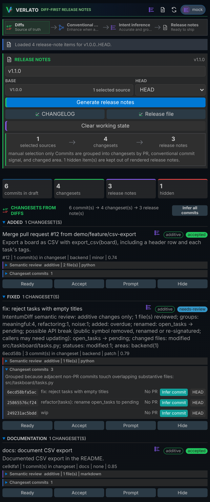

# Verlato

{ width="96" align="right" }

**Verlato turns your git history into release notes you can trust.** It reads the commits
between two refs, groups them into pull-request-sized changesets, works out what each one
actually changed, and drafts a changelog entry and GitHub release notes for you to review and
apply.

What makes it different is the evidence. Verlato is powered by the
[IntentumDiff](https://github.com/buchochelliq-labs/intentumdiff-core) semantic diff engine,
which reviews every commit and tells Verlato whether a change is behavioural, purely
additive, a refactoring or move, or formatting only, and which functions, methods and
classes were added, removed, renamed or re-signatured. A commit called `wip` that renames a
public function is flagged for review as a possible breaking change; a `feat:` commit that
only reformats code is flagged as a contradiction.

{ width="420" align="right" }

You can use Verlato in three ways, all backed by the same native program:

- **The command line:** `verlato draft preview --from-latest-tag` prints release notes for
  everything since your last tag. See [The command line](guide/cli.md).
- **The VS Code extension:** review changesets, see the semantic review, ask a model for
  better wording, and apply the notes to `CHANGELOG.md` or a release file without leaving
  the editor. See [The VS Code extension](guide/vscode.md).
- **An MCP client** such as GitHub Copilot or Claude: `verlato serve` gives agents tools to
  scan, review and apply release notes, and to read the semantic diff. See
  [The MCP server](guide/mcp.md).

Models are optional. Without one, Verlato classifies and summarises changes
deterministically from commit messages, labels and the semantic review. With one (a local
[Ollama](https://ollama.com) model by default, or LiteLLM, GitHub Models, the Codex or
Claude Code CLIs, or your own plugin) it can suggest better summaries, under a
[privacy mode](guide/privacy.md) you choose. Models see IntentumDiff's semantic diff, never
your raw patches, unless you allow it.

## Where to start

[Getting started](getting-started.md)
:   Install Verlato and produce your first release notes in a minute.

[User guide](guide/index.md)
:   Concepts, the CLI, the VS Code extension, models, privacy, style and MCP.

[Reference](reference/index.md)
:   Every command and flag, `verlato.json`, environment variables, protocols and output formats.

[Technical guide](technical/index.md)
:   Architecture, the semantic evidence, extension points, building, testing and releasing.

## Open source, open core

Verlato's core (this documentation) is open source under the Apache License 2.0, at
[buchochelliq-labs/verlato-core](https://github.com/buchochelliq-labs/verlato-core).
Everything one developer needs is free; team and organisation features are built
separately on core's public extension points. See [Open core](open-core.md).
