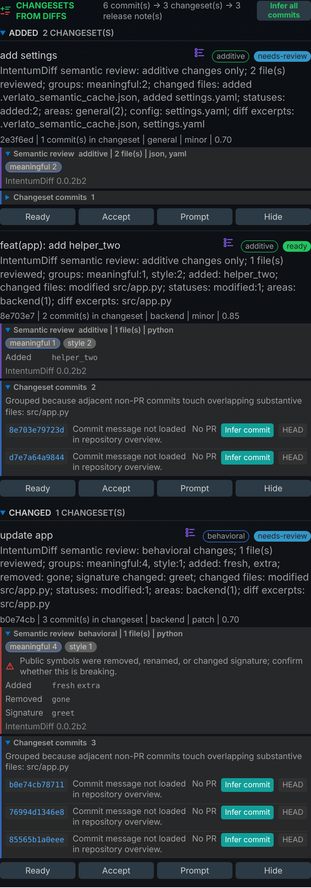

# Verlato for VS Code

Diff-first release notes. Understands your code changes. Writes your releases.

Verlato drafts your changelog and GitHub release notes from the commits since your last
release, and lets you review them in the side bar. It is powered by the
[IntentumDiff](https://github.com/buchochelliq-labs/intentumdiff-core) semantic diff engine:
every changeset shows whether it is behavioural, additive, a refactoring or move, or
formatting only, and which symbols were added, removed, renamed or re-signatured. Changesets
with possible API breaks, protected-config changes, or commit messages that contradict the
review are routed to **needs-review**.



## Features

- **Control view:** pick a base and head, generate the draft, and review every changeset with
  its semantic review, commits and confidence. Accept, edit or hide items.
- **Model suggestions:** ask a model (local Ollama by default; or LiteLLM, GitHub Models, the
  Codex or Claude Code CLIs, or a plugin) for better wording, in the tone you choose, then
  apply the one you like. Models see the semantic diff, never raw patches, unless you allow
  it.
- **Conventional Commits:** infer a Conventional Commit message for any commit from its diff.
- **Apply:** write the notes to `CHANGELOG.md` or a release file in one click.
- **Releases, Activity and Sources views:** the rendered notes, live request and model
  activity, and the tags, branches, commits and releases a range can start from.
- **MCP:** start Verlato's MCP server for Copilot agent mode from the Control view.

## Requirements

The extension runs the `verlato` program. Install it with `pip install verlato`, or download
a release bundle from [GitHub Releases](https://github.com/buchochelliq-labs/verlato-core/releases)
and set **`verlato.cliPath`** to its `verlato` executable. Run **Verlato: Show IntentumDiff
Engine Status** to check the installation.

## Getting started

1. Open a git repository and click the Verlato icon in the activity bar.
2. Choose the base (for example your latest tag) and head, set the version, and click
   **Generate release notes**.
3. Review the changesets, starting with those in **needs-review**.
4. Apply to the **CHANGELOG** or the **Release file**.

## Settings

The most useful settings:

| Setting | Default | Purpose |
|---|---|---|
| `verlato.cliPath` | `verlato` | the `verlato` executable |
| `verlato.diffEngine` | `intentumdiff` | `intentumdiff` semantic review, or `git` text patches |
| `verlato.modelProvider` | `ollama` | the model provider, or `configured` to use `verlato.json` |
| `verlato.ollamaModel` | `gemma4:latest` | the Ollama model |
| `verlato.modelPrivacy` | `metadata-only` | what models may see |
| `verlato.suggestionTone` | `release-note` | `release-note`, `concise`, `technical` or `customer-facing` |

Every setting and command is described in the
[VS Code extension guide](https://buchochelliq-labs.github.io/verlato-core/guide/vscode/).

## Documentation

<https://buchochelliq-labs.github.io/verlato-core/>: getting started, the full user guide,
and the reference for the CLI, configuration and protocols.

## Development

From the repository's `vscode-extension/` directory:

```sh
npm ci
npm run build
npm test
npx @vscode/vsce package
```

Press **F5** from the repository root to start an Extension Development Host. See
[Building from source](https://buchochelliq-labs.github.io/verlato-core/technical/building/#the-vs-code-extension).

## License

Apache-2.0. See [LICENSE](LICENSE).
